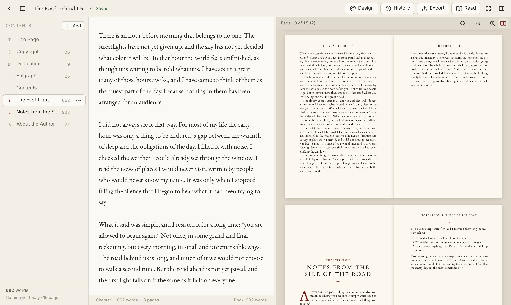

# SerifWriter

A private, offline writing app that typesets your words into book pages **as you write**.
Your manuscript lives in your browser's own database on your Mac — no accounts, no servers —
and appears beside you as a real book: drop caps, small capitals, running heads, fleurons.
For scholars it also sets citations and a bibliography from BibTeX, TeX mathematics, numbered
sections, and numbered figures, tables and equations with cross-references.



## Install it (once)

You need [Node.js](https://nodejs.org) 20 or newer.

```bash
npm install
```

```bash
npm start
```

Then open **http://localhost:4173** in **Chrome** and click the *Install* icon at the right of the
address bar (or ⋮ ▸ *Cast, save and share* ▸ *Install page as app*). SerifWriter is now in your
Dock and Launchpad and opens instantly, **with no internet and without `npm start` running** — the
whole app, fonts included, is cached by its service worker.

* **Keep using the same address.** Browsers keep data per address, so a book written at
  `localhost:4173` lives there. Use *Backup* ▸ *Download backup* to move books anywhere else.
* **Updates are automatic.** While `npm start` runs, it checks GitHub every 15 minutes; a new
  version is pulled, rebuilt and swapped in, and the open app shows *“A new version is ready —
  Restart”* (an update waiting when you open the app is applied straight away). Local edits or a
  failed build leave the current version running.
* **Always on (macOS):** `npm run autostart` runs the server in the background whenever you're
  logged in, so the app stays current without a terminal; `npm run autostart -- off` undoes it.
  Its log is `serifwriter.log`.
* **Safari (macOS Sonoma):** open the address and choose *File ▸ Add to Dock*. Everything works
  except mirroring to a folder (Safari doesn't support it) — use zip backups there.
* You can also host the `dist/` folder on any static host. This repository publishes itself to
  GitHub Pages for the iPhone (below). Your writing still never leaves your machine.

## On your iPhone

SerifWriter also runs on an iPhone (or iPad) as a Home Screen app, published from this repository
to GitHub Pages at **https://theunseenspirit.github.io/SerifWriter/**.

1. Open that address in **Safari** and tap *Share* ▸ *Add to Home Screen*.
2. Open SerifWriter from the Home Screen. From then on it opens with no connection, and it updates
   itself whenever a new version is published (every merge into the default branch publishes one).

**Once, before the first install:** GitHub Pages has to be switched on for the repository. On
GitHub, open the repository's *Settings ▸ Pages*, set *Source* to **GitHub Actions**, then open
*Actions ▸ Publish the app ▸ Run workflow*. After that every merge publishes on its own.

Add it to the Home Screen *before* you write: books written in a Safari tab stay in Safari's
storage, separate from the Home Screen app's. Your writing stays on the phone — only the app is
published.

On the phone the writing room shows one pane at a time, **Write** or **Pages**, with the contents in
a drawer (the sidebar button, top left) and everything else under ⋯. A row of keys above the
keyboard gives what a phone keyboard lacks: ⇥ and ⇤ to indent or outdent a line (Tab and ⇧Tab),
bold, italic, a footnote and a citation; ⌄ puts the keyboard away. *Symbols ›* swaps in a row of
logic symbols (∴ ∵ ¬ ∧ ∨ → ↔ ∀ ∃ □ ◇ ⊢ ⊨ ⊥) and *All…* for the full list; ‹ goes back. ⋯ also
has *Indent new paragraphs* and *Return starts a new line* as one-tap toggles. LaTeX names work as on the Mac (`\forall` and a space gives ∀). Tap a page in
*Pages* to write at that paragraph. *Design* opens as a sheet over the pages, so each change shows
as you make it. Turn the phone sideways for a wider editor; *Read* turns pages with a swipe.

### Moving a book between your Mac and your iPhone

Each device keeps its own books — there is no server to sync through. To carry a book across:

1. On the Mac, in the library: ⋯ on the book ▸ *Download this book (.zip)*, then AirDrop the file
   to your iPhone (or save it to iCloud Drive).
2. On the iPhone: *Import* ▸ *Backup (.zip)…* and pick it in Files.
3. To bring it back: on the iPhone, ⋯ on the book ▸ *Save or send this book (.zip)…* opens the share
   sheet (AirDrop to your Mac, or Save to Files); then *Import* it on the Mac.

When the book is already there, the import says which copy was edited more recently before you
choose *Replace* or *Keep both*, and a version of the copy being replaced is saved in History first,
so nothing is lost either way.

## Your words are safe

| Layer | What happens |
|---|---|
| Autosave | 0.35 s after you pause (and every 2 s while typing nonstop), atomically, to IndexedDB. No save button. |
| Crash journal | When the tab closes or the Mac sleeps, unsaved text is written synchronously to a local journal and replayed on next launch. |
| Persistent storage | The app asks the browser to never evict its data. |
| Version history | A version every 10 minutes of writing, each time you open a book, and before any delete or restore; name versions to keep them forever. Paragraph diffs; restore a whole book or one chapter. |
| Folder mirror | *Back up to a folder…* (Chrome/Edge): every book is mirrored as plain `.md` files with YAML front matter plus `project.json` — readable in any editor, importable back. |
| Zip backup | One click: every book as Markdown + settings (+ history if you like). *Import* restores it. |

## Writing

Full CommonMark + GitHub-flavoured Markdown: `*italic*`, `**bold**`, `~~strike~~`, `> quotes`,
lists and task lists, tables, `` `code` `` and fenced code, links, autolinks, footnotes, images
(paste or drag them in), raw HTML (sanitised), and TeX math.

| You type | You get |
|---|---|
| `---` on its own line, with a blank line before it | a scene-break ornament |
| `\forall`, `\neg`, `\to`, `\Box`, `\vdash`, `\therefore` + space | ∀ ¬ → □ ⊢ ∴ — logic and philosophy symbols by their LaTeX names (not inside math or code) |
| `{^Plato}`, `{^Plato!Republic}` | an index entry (prints nothing) — and a subentry |
| <kbd>Tab</kbd> at the start of a line | an indented line, set one per line — premises, propositions, verse (two tabs: further in; ⇥ on the iPhone) |
| `Text.[^1]` … `[^1]: The note.` | a footnote at the foot of the page (or chapter endnotes) |
| `Text.^[The note, inline.]` | the same footnote, written in place |
| `# Heading` at the top of a chapter | the chapter's title (the opening page) |
| `#`…`######` elsewhere | part / chapter / section / subsection… — configurable per template |
| `<!-- pagebreak -->` | a page break |
| `"quotes"`, `--`, `---`, `...` | “curly quotes”, en dash, em dash, ellipsis |
| `[@key]`, `[see @key, 33–35; @other]` | a citation: (Doe 2001, 33–35), [1, 33] or a footnote, by style |
| `[-@key]`, `@key`, `@key [33]` | year only (2001); narrative Doe (2001) or Doe (2001, 33) |
| `$e^{i\pi}+1=0$`, `$$ … $$` | inline and display mathematics (`\tag{1}` numbers an equation by hand) |
| `{#fig:map}` | Figure 1. A map — a numbered figure |
| `Table: Results {#tbl:res}` beside a table | Table 1. Results — a numbered caption above it |
| `$$ … $$ {#eq:gauss}` | an equation numbered (1) |
| `@fig:map`, `[see @tbl:res]`, `@eq:gauss` | Figure 1, see Table 1, Equation (1) |

**Paragraphs and line breaks** (*Design ▸ Paragraphs & line breaks*, or ⋯ on the iPhone): by default a book is set like a printed
one — a blank line starts a new paragraph with its first line indented, and a single Return runs on
into the same paragraph, as in Markdown. Turn off **Indent new paragraphs** to set every paragraph
flush left, and turn on **Return starts a new line** to make each Return a new line in the book.
With both, the text is set line for line as you typed it: premises, propositions, verse, addresses.
**Space between paragraphs** sets paragraphs apart with space instead of an indent. All three are
kept per book and carried into the PDF, EPUB, Word and HTML exports.

**Book details** are YAML front matter in the *Title Page* section (or *Book details* in the top bar):

```yaml
---
title: |
  The Road
  Behind Us
subtitle: Essays on Leaving and Arriving
author: Your Name
publisher: Privately Printed
year: MMXXVI
---
```

A line break in the title is where it breaks on the title page. For the Manuscript template you can
add `legal_name`, `address`, `email`, `phone`, `pen_name`, `surname` and `short_title`. The copyright
page understands `{author} {title} {year} {thisYear} {publisher} {font}`.

**Page types** (*Add* in the sidebar): title page, copyright, dedication, epigraph, contents
(generated, with page numbers — parts and chapters, plus sections and subsections as you choose in
*Design ▸ Headings*), part divider, chapter, unnumbered chapter (preface, afterword…),
about the author, bibliography. Drag to reorder, or select one and press ⌥↑ / ⌥↓.
The selected one also shows its own sections (`## `) and subsections (`### `), indented
beneath it; click one to jump there. Click the selected entry again to fold them away.

### Citations and bibliography

Add a **Bibliography** section and paste your BibTeX into it — a Zotero, Mendeley, JabRef or
Google Scholar export works as is (BibLaTeX `date`, `journaltitle` and `location` too). Cite with
Pandoc's syntax above, or press ⌘⇧K to search the bibliography and insert one. The bibliography page lists the works you cite (all of them until you cite
one), with accents, `{Braces}` and `\emph{}` understood, and same-author-same-year works told apart
as 2001a / 2001b. *Design ▸ Notes & flow ▸ Citations* chooses the style for the whole book:

* **Author–date** (Chicago author–date): (Arendt 1958, 7–9) and an alphabetical reference list.
* **Numeric**: [1, 7–9], numbered in order of first citation.
* **Notes** (Chicago notes–bibliography): each citation becomes a footnote — a full note the first
  time a work is cited in a chapter, a short note after. Citations inside your own footnotes are
  set in place.

A key missing from the bibliography shows in red. Citations come out right in every export.

### Cross-references

Label a figure, table or equation as above and refer to it anywhere in the book with `@fig:…`,
`@tbl:…` or `@eq:…` (Pandoc-crossref syntax). Each kind is numbered in order through the book, and
the numbers follow when you move things around. An unknown label shows in red.

### Index

Mark a term where it is discussed — select it and press ⌘⇧X, or type `{^Term}` — and add an
*Index* section (*Add* ▸ *Index*). It lists every term alphabetically under letter heads, with
subentries (`{^Term!Subterm}`) and page numbers that follow the pages as the book changes
(consecutive pages become ranges: 12–14). The index is part of the PDF; e-books and Word files,
which have no fixed pages, leave it out.

### Symbols

Type a symbol's LaTeX name and a space: `\forall` ∀, `\exists` ∃, `\neg` ¬, `\wedge` ∧, `\vee` ∨,
`\to` →, `\leftrightarrow` ↔, `\Box` □, `\Diamond` ◇, `\vdash` ⊢, `\models` ⊨, `\therefore` ∴,
`\bot` ⊥, `\in` ∈, `\subseteq` ⊆, `\ulcorner`/`\urcorner` ⌜⌝, Greek letters and more (⌘⇧L shows
them all). Prefix operators stay tight to what follows, so `\forall x` gives ∀x. Names inside
`$math$` and `code` are left alone; whole formulas read best as math. In the book, symbols the
text font lacks are set in a matching serif symbol font (STIX Two on macOS, Cambria Math on Windows).

### Mathematics

`$…$` is inline and `$$…$$` display math, in LaTeX syntax, set as MathML (a dollar followed by a
space or a digit after the closing one — “$5 and $10” — stays a dollar). The maths engine loads only
for books that contain math. Errors show in red, with the message on hover.

### Keyboard

| Keys | |
|---|---|
| ⌘B / ⌘I / ⌘K | bold / italic / link |
| ⌘⇧N | footnote at the caret: `^[…]`, written right where it belongs |
| ⌘S | save now (it already saved) |
| ⌘F | find & replace in the whole book (match case, whole words, regular expressions) |
| ⌘⇧K | insert a citation: search your bibliography by author, year, title or key |
| ⌘⇧L | insert a symbol: logic, philosophy and maths, searchable by name or meaning |
| ⌘⇧X | add the selected word to the index |
| ⌘⇧F | focus mode (Esc to leave) |
| ⌘\\ | show/hide the sidebar |
| Return in a list or quote | continues it; Return on an empty item ends it |
| Tab / ⇧Tab | indent / outdent the line or the selected lines (in a list: the item) |
| Reading mode | ← → Space PageUp PageDown Home End, Esc to close |

Click anywhere on a page in the preview to jump to that paragraph in the editor. Drop a `.bib`,
`.md` or `.txt` file onto the editor to insert its text, or an image to place it.

## Writing stats

Click the word count at the bottom left (in the sidebar, or under the editor when the sidebar is
hidden), or the chart icon in the top bar, to see how you write. Everything is recorded as you type
and stays on your computer.

* **Habits:** words today (against an optional daily goal), your writing streak and best streak,
  the last seven days, an average writing day, time spent writing and your pace in words an hour,
  and the book's length against an optional target.
* **Words per day** for the last 30 days, with your goal marked and a table view.
* **Writing days** for the last six months, as a calendar.
* **When you write:** minutes by hour of day, to find your best hours.
* **Book length over time**, and **chapter lengths** side by side, to see the book's balance.
* **The prose:** average and longest sentence, Flesch reading ease (English), vocabulary variety
  per 1,000 words, and your most-used words, so repetitions stand out.

Words per day are *net*: cutting a page counts against the day, as it should. Writing time counts
the stretches you are typing, with pauses under two minutes. Stats travel with the book in
backups and the folder mirror.

## Design

Six templates, each a folder of **JSON settings + CSS** (`src/templates/<id>/`):

* **Classic Leather** — the flagship, after the `demo.tex` prototype: 6 × 9 in, mirrored margins
  (0.95/0.8/0.9/1.0 in), Cardo 11 pt, real small caps and old-style figures, ink `#1E1A16` and
  rubric `#7A1E1E`, double-rule title page with corner flourishes, openings a third down the page,
  3-line drop caps with the first words in small caps, centred spaced-capital running heads.
* **Modern Literary** — Crimson Pro, 5.5 × 8.5, big chapter numerals, flush-left openings.
* **Manuscript** — standard submission format: Letter, 12 pt, double-spaced, 1 in margins, ragged
  right, `Surname / TITLE / page` header, word count on the cover page.
* **Ornate Victorian** — Libre Baskerville, ruled running heads, scrollwork, framed title page.
* **Pocket Edition** — 5 × 8, EB Garamond with Cormorant display, italic heads, roman numerals.
* **Scholarly Monograph** — a university-press interior: 6 × 9, EB Garamond, author–date citations,
  page footnotes, flush-left openings, chapter and section running heads, small capitals for
  abbreviations. Sections are unnumbered, so you can number them yourself.

*Design* adjusts everything: accent presets or any colour, ink and paper, text and display fonts
(Cardo, EB Garamond, Crimson Pro, Libre Baskerville, Cormorant — all bundled, all offline), size,
line spacing, indent, justification, hyphenation, page size (5 × 8, 5.5 × 8.5, 6 × 9, Royal,
7 × 10, A5, A4, Letter),
margins, two-sided layout, where chapters start and how far down, chapter/part labels, drop caps and
the small-cap lead-ins beside them, ornament sets, scene breaks, running heads and folios, heading roles, footnote
placement, citation style, section numbering, section running heads, small caps for abbreviations,
widows/orphans, and custom CSS. *Save as new template* keeps it for every book; templates
export and import as `.json`.

## Export

* **PDF** — print-ready, the exact preview pages at trim size with embedded fonts, through the
  browser's print engine (choose *Save as PDF* in Chrome). Optional ⅛″ bleed (outside, top, bottom).
* **EPUB 3** — reflowable, fonts embedded, nav, popup footnotes, images, MathML.
* **DOCX** — Word styles, real footnotes (citation notes included), lists, tables, images, Word
  drop caps, page setup. Math is kept as its TeX source.
* **HTML** — one self-contained file (fonts and images inside).
* **Markdown** — the whole book in one `.md` with front matter (a `.zip` if it has images);
  citations stay as `[@key]` and the bibliography as a `bibtex` block, ready for Pandoc.

## Performance

Measured with Chromium's CPU throttled 4× (≈ a 2018 MacBook Air) on a 120,000-word, 350-page book
(`node tests/e2e/perf.cjs 4`): whole book typeset in ~2.5 s; keystroke latency median 16 ms,
95th percentile 24 ms, worst 32 ms (one frame); after you pause, only the edited chapter is
re-paginated (~70 ms, in slices that yield to typing). At 6× throttle: worst keystroke 56 ms.

The app is ~105 KB of gzipped JavaScript plus ~1 MB of fonts, all cached for offline use; the maths
engine (60 KB) loads only for books with math.

## Development

```bash
npm run dev        # live-reloading dev server
npm run build      # type-check and build to dist/
npm test           # unit tests (Node's built-in runner)
npm run e2e        # browser tests against `npm run preview` (needs Playwright installed)
```

Architecture, the PWA-vs-Tauri decision and the custom paginator are explained in
[docs/ARCHITECTURE.md](docs/ARCHITECTURE.md).

## Fonts

Math is set in the system's maths font (STIX Two Math on macOS, Cambria Math on Windows).
Cardo, EB Garamond, Crimson Pro, Libre Baskerville and Cormorant are licensed under the
[SIL Open Font License 1.1](public/fonts/licenses/) and bundled, subset to Latin with all OpenType
features kept.
